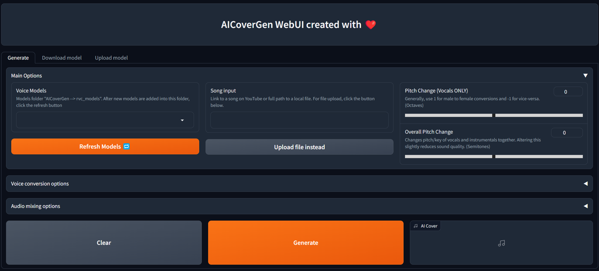
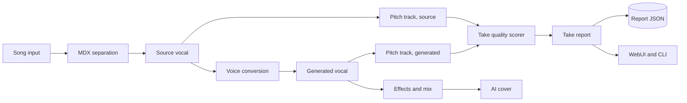

# Vocal Take Check

Scores every generated vocal take for pitch drift and artifacts before it ships.



## Why

Voice conversion tools produce a cover in one pass and leave the judgement to the ear. A take can sound right for two verses and then crack on one held note, and the only way to find that line is to listen to the whole song again. People who generate many takes spend most of their time listening rather than choosing. Vocal Take Check compares the generated vocal against the pitch of the source vocal and turns that comparison into a score and a list of time ranges, so a take can be judged in seconds.

## How it works

The pipeline separates the song into vocals and instrumental, converts the main vocal with the selected voice model, and mixes the result. After the conversion step, `score_take` in `src/take_quality.py` loads both the source vocal and the generated vocal, extracts a pitch track from each with `VC.get_f0` from `vc_infer_pipeline`, the same f0 helper the conversion uses, and aligns the two tracks on their voiced frames. `_cents` measures how far each frame drifts, and `_ranges` turns the frames past the 60 cent threshold into contiguous time ranges of at least a quarter second. The result is a correlation score, a median drift, a per-frame drift series and the flagged ranges. `write_report` in `src/take_report.py` writes that result as a small JSON file next to the cover, and `summary_line` and `ranges_block` render a one-line summary plus a short text block of flagged ranges, which the command line prints and the WebUI shows in the take quality report box under the generated audio.



## Key decisions

- The check reuses the pitch extraction already in the conversion pipeline instead of loading a second pitch model, which keeps the extra cost to one pass over each file but ties the check to the same f0 method the take was made with.
- Drift is measured only on frames where both tracks are voiced, so silence and breath are not counted as errors; the cost is that a take which drops a word entirely can still score well.
- The report is a plain JSON file written beside the cover rather than a database row, so a take folder stays self-contained and can be moved or shared without the app.
- Flagged ranges are merged into contiguous spans before they are shown, which makes the output readable but loses the exact frame where a drift starts.

## Tech stack

- Python 3.10
- PyTorch 2.0.1 and ONNX Runtime for the separation and conversion models
- librosa, NumPy and soundfile for audio loading and pitch analysis
- Gradio 3.39 for the WebUI
- Docker for a reproducible runtime

## Quick start

Prerequisites: Python 3.10, ffmpeg on the PATH, and the model files listed in `rvc_models/MODELS.txt` and `mdxnet_models/model_data.json`.

```bash
pip install -r requirements.txt
python src/download_models.py
python src/webui.py --listen --listen-port 7860
```

The command line entry point runs the same pipeline without the browser:

```bash
python src/main.py --song "input/song.mp3" --voice_model my_voice --pitch_change 0
```

## Usage

After a cover is generated, the take report is written next to it and the summary is printed:

```text
[+] AI Cover generated in song_output/a1b2c3d4e5f/
[~] Scoring take against source vocal...
Take score: 0.91 (median pitch correlation 0.94)
Flagged ranges: 00:41.2-00:43.8, 01:57.0-01:58.4, 02:36.5-02:37.1
Report: song_output/a1b2c3d4e5f/song_my_voice_p0_i0.5_fr3_rms0.25_pro0.33_rmvpe_take_report.json
```

## Project structure

```text
src/
  main.py              pipeline entry point and CLI
  webui.py             Gradio interface
  rvc.py               model loading and inference wrapper
  vc_infer_pipeline.py voice conversion and f0 extraction
  take_quality.py      pitch comparison and drift scoring
  take_report.py       JSON report and text summary
  mdx.py               vocal and instrumental separation
  infer_pack/          model definitions
mdxnet_models/         separation model parameters
rvc_models/            voice models and public model index
song_output/           generated covers and take reports
```

## Limitations

- The score compares pitch only, so a take with correct pitch but a wrong timbre or a noisy tail is not flagged.
- Takes shorter than about ten seconds of voiced audio give an unstable correlation and should be judged by ear.
- The check runs on CPU after conversion and adds time to every generation, even when the take is obviously good.
- Only the main vocal is scored; backup vocals and the mixed cover are not checked.

## License

MIT. The licence text is in LICENSE.
